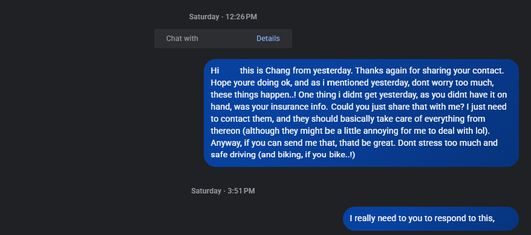

Again, just directly sharing what I posted in our [lab](https://kundajelab.github.io/) Slack.

"  
I was biking back home friday night from the gym, in a bright orange rain jacket, helmet, bike light, and all, unfortunately got mildly hit by a car in the roundabout in front of evgr, while i was already in the roundabout, and the driver just tried to enter and hit me (no right of way). Thankfully not really hurt (+helmet was v important, even for a minor crash, as the momentum almost 100% bonks your head on the road). Turns out it was some stanford undergrad who was probably new to driving. A little dazed, people around very kindly helped me and called the police/paramedics, thankfully all settled well. And i felt bad for the driver too, because its probably stressful knowing you hit someone, and you’re young and worried, and ive been in minor accidents before too (although not hit a biker) and know it can be stressful. I actually go out of my way to talk to him, calm him down, tell him not to worry, that these things happen all the time, dont stress too much, etc. But a few things start to be off: (1) The driver, right after the accident, goes to “park” and takes about 30 min to come back (all the while we’re all really hoping he doesnt run away and make this a hit-and-run). (2) He says he doesnt have insurance info with him, its with his parents, and will send it later, but does give me his contact (through the police). Next day I message him to get his insurance, while again, telling him not to worry, that insurance usually handles it all, etc. But (3) i dont get any response until i double text again in the evening, and only get a response saying that his parents still havent sent it and will send it tomorrow. (4) Next day, I text again, formally telling him that its legally required to share insurance info, and only then, do i get a photo of an insurance card. (5) Turns out IT’S THE WRONG INSURANCE. AN INSURANCE FOR A DIFFERENT CAR. (6) In the meantime, he keeps suggesting we handle outside of policy. (7) And only once i tell him i need the insurance for the car involved in the accident, he says itll take another day to get it. All very strange, from my pov, frustrating and a huge waste of time, with a question of: _“Is this how i would’ve dealt with this situation?”_

Turns out (i think, still giving him the benefit of doubt on a lot of things) he was driving his friend’s car, didnt want the accident to go towards his friend’s record (and premiums), thought he could cover it with his car’s insurance (which doesnt work since the policy only covers that car + that insurance isnt even technically his, and under his parent’s name since its his parent’s car).

It all ends with his friend (the car owner) stepping in, initially trying to push to settle by (mildly) threatening that i didnt have a bike light (which, unfortunately for them, i did and the police report covered it), then acknowledges that they were in the wrong but would still prefer to not file with insurance (still not exactly sure why), and so i just have some of my bike repair things covered, which is all i wanted initially anyway.

But it really brought back to light some issues ive been feeling recently—possibly towards stanford undergrad especially, but also to many undergrad institutions: I really dont know if schools are informing good moral values to young students.

At colleges right now, you’re brought up to think that you can achieve anything (and deserve/should/be able to achieve anything; “entitlement”) + while experiencing essentially no responsibilities or repercussions, as the schools “protect” you as your “protectorate”, while the school as the larger/older/wiser “institution” takes all the blame for you. Coincide with covid during early development + agents for even more autonomy + ad-based social media, i think we’re really at a pinnacle where young students are just not learning morals/principles/values from institutions.

Related, this year, i’m somehow (already) at a point in my phd where i’ve (thankfully) learned some things, that (thankfully) seem valuable to others (eg high school, undergrad, masters, 1st year phd), where i can actually help them a little bit, tell them what i wish i knew when i was in their shoes + pay back what i received while getting here. And ive somewhat (proudly) been trying to do as much as i can these past few months, in various different forms (learning from the best: AK). But at the same time, i’d also been feeling a little torn about how much time it was actually taking up (not only away from research, but personal too), whether it was worth it (for me, and for them), and it didnt feel great _not_ feeling like this was a great use of my time. But i believed (and still believe) it was 100% worth it, something i should keep doing, that i owe/will improve/be net good for me and for others, and do as much as i can, confident that i can know when, sometimes if needed, to draw the line.

Nothing changes drastically from this, but maybe the only thing that has slightly changed is how to think about “help”: I really dont think blind protectorat-ism, taking away all the burden off their shoulders, without full acknowledgement of what’s going on, is the right way to go about it anymore. Assuming learning is the goal—to be ready when another, similar experience happens—what’s most helpful to learn is what others arent teaching. Protectoratism used to be rare, and hence helpful in learning. Right now, values, responsibility, and just how to be good person in order to live with others is what might be scarce 🫠

Just wanted to share these thoughts as we think about how to sustainably, and optimally, keep the community going..! (And im sure from the other side, others view us this way too lol so gotta do better ourselves too 😅)
"  
@ 9:48 PM  
---
"  
Screenshot of my first text to the driver (anonymized):

  
"  
@ 9:54 PM  